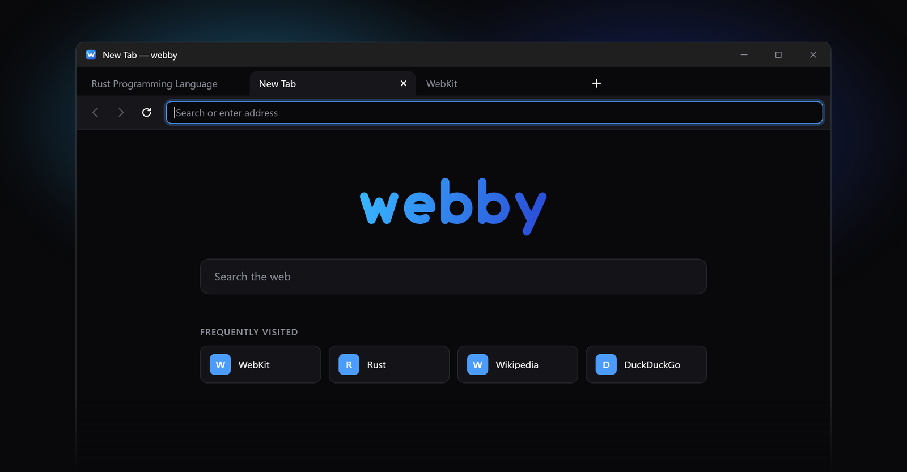
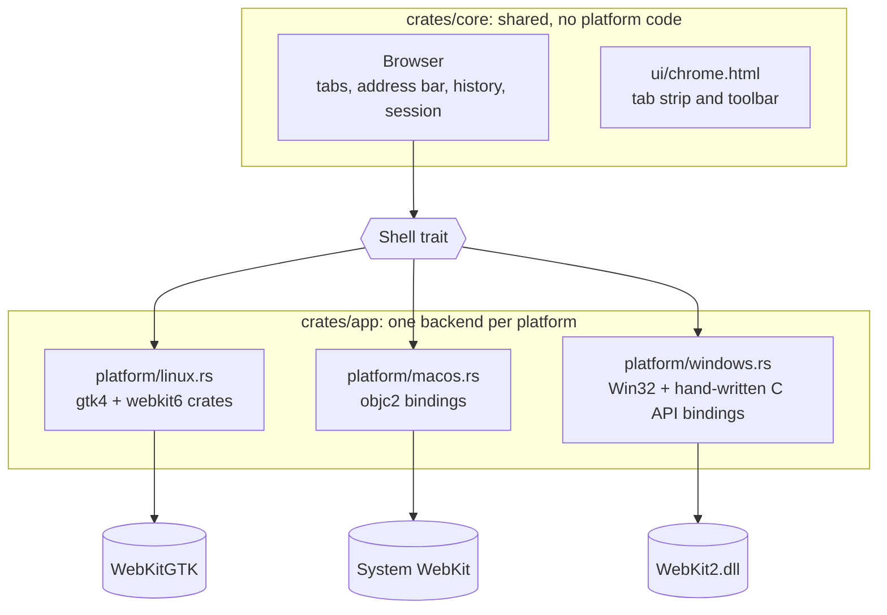
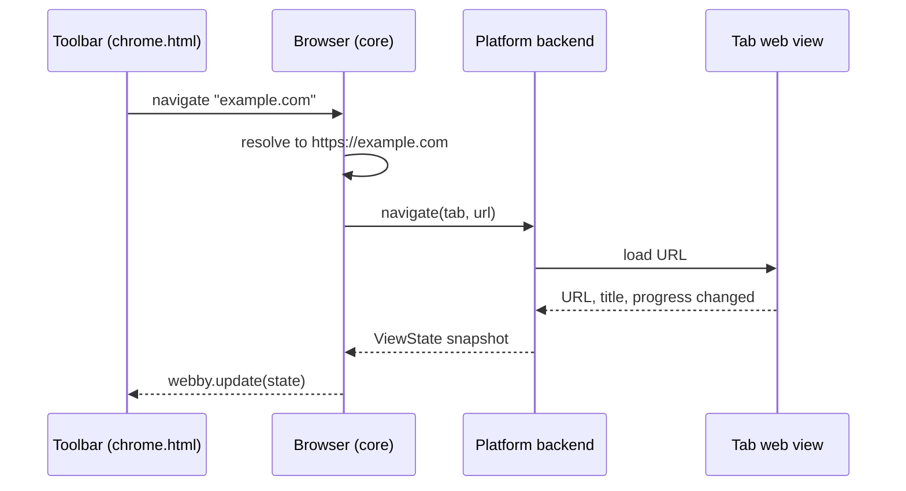

<h1></h1>

A small web browser written in Rust that renders with **WebKit on every
platform**, including Windows, where Safari has not been available since
2012.



## Download

Get the installer for your system from the
[latest release](https://github.com/rcdelacruz/webby/releases/latest).

| System | File | Install |
| --- | --- | --- |
| Windows 10/11 (64-bit) | `webby-<version>-windows-x64-setup.exe` | Run it. Installs for your user only; no administrator prompt. WebKit is included. |
| macOS 11 or later (Apple silicon and Intel) | `webby-<version>-macos.dmg` | Open it and drag webby to Applications. |
| Debian / Ubuntu (64-bit) | `webby_<version>_amd64.deb` | `sudo apt install ./webby_<version>_amd64.deb` |

The installers are not code signed yet, so the system will warn you the
first time:

- **Windows:** SmartScreen shows "Windows protected your PC". Choose
  *More info*, then *Run anyway*.
- **macOS:** right-click webby in Applications and choose *Open*, then
  *Open* again.

## Status

| Platform | Engine | State |
| --- | --- | --- |
| Linux | WebKitGTK 6.0 (GTK 4) | Runs; tested end to end |
| macOS | System WebKit (`WKWebView`), the engine Safari uses | Builds and packages in CI; not yet tested by hand |
| Windows | WebKit's own Windows port (`WebKit2.dll`); no WebView2, no Chromium | Builds and packages in CI; not yet tested by hand |

The macOS and Windows backends were written on Linux. If something
misbehaves there, please open an issue.

## Features

- Tabs: open, close, switch, middle-click to close. `window.open` and
  `target=_blank` open as a tab next to the current one.
- Address bar that accepts URLs, bare hosts (`example.com`,
  `localhost:3000`) and search terms (DuckDuckGo).
- Back, forward, reload, stop, load progress and an HTTPS indicator.
- Start page listing the sites you visit most.
- History and session restore: tabs reopen where you left off.
- Light and dark appearance, following the system.

### Keyboard shortcuts

| Action | Linux / Windows | macOS |
| --- | --- | --- |
| New tab | Ctrl+T | ⌘T |
| Close tab | Ctrl+W | ⌘W |
| Address bar | Ctrl+L | ⌘L |
| Reload | Ctrl+R, F5 | ⌘R |
| Back / forward | Alt+← / Alt+→ | ⌘[ / ⌘] |
| Next / previous tab | Ctrl+Tab / Ctrl+Shift+Tab | ⌃Tab / ⌃⇧Tab |

### Where your data lives

History and the open-tabs session are plain files in the platform data
directory:

| System | Directory |
| --- | --- |
| Linux | `~/.local/share/webby` |
| macOS | `~/Library/Application Support/webby` |
| Windows | `%APPDATA%\webby` |

Set the `WEBBY_PROFILE` environment variable to use another directory.

## Building from source

You need Rust 1.88 or newer.

**Linux** (Debian/Ubuntu package names):

```sh
sudo apt install libgtk-4-dev libwebkitgtk-6.0-dev
cargo run --release
```

**macOS:**

```sh
cargo run --release
```

**Windows** (MSVC toolchain, PowerShell):

```powershell
cargo build --release
.\scripts\fetch-webkit-windows.ps1 -Destination target\release
.\target\release\webby.exe
```

On Windows, webby loads `WebKit2.dll` when it starts, so the build itself
needs no WebKit SDK. Apple publishes no Windows binaries of WebKit; the
script downloads the build of WebKit's Windows port that the Playwright
project publishes for browser testing and unpacks it next to `webby.exe`.
To use a WebKit you built yourself from
[webkit.org](https://webkit.org/webkit-on-windows/) sources, zip its `bin`
directory and point `WEBBY_WEBKIT_URL` at it.

### Building the installers

| Platform | Command | Output |
| --- | --- | --- |
| Linux | `packaging/linux/build-deb.sh` (after `cargo build --release`) | `dist/webby_<version>_<arch>.deb` |
| macOS | `packaging/macos/build-dmg.sh` | `dist/webby-<version>-macos.dmg` |
| Windows | Inno Setup with `packaging/windows/webby.iss` | `webby-<version>-windows-x64-setup.exe` |

CI builds all three on every push and attaches them to the workflow run.
Pushing a tag such as `v0.1.0` publishes them as a GitHub release.

## How it works

The window holds one small web view for the browser's own interface (the
tab strip and toolbar) and one web view per tab. All browser logic lives
in a platform-independent core; each platform only creates windows and
web views and reports what they do.



The interface is the same HTML document on all three platforms. It talks
to the core through a script message handler that only that one web view
has, so web pages can never send commands to the browser.



Every event goes through one queue (`Runtime`), so the browser is never
re-entered when a toolkit fires a callback from inside the call that
caused it.

| Path | What it holds |
| --- | --- |
| `crates/core/src/browser.rs` | Tab model and the rules that drive it |
| `crates/core/src/omnibox.rs` | Turns address-bar input into a URL or a search |
| `crates/core/src/store.rs` | History and session files |
| `crates/core/src/startpage.rs` | The new-tab page |
| `crates/core/ui/chrome.html` | The tab strip and toolbar |
| `crates/app/src/platform/` | The three platform backends |
| `packaging/` | Icons and installer scripts |

## Not there yet

- Downloads, bookmarks, find in page, a history view, private windows
- Permission prompts (camera, location, notifications)
- Error pages and JavaScript dialogs (`alert`, `confirm`) on macOS and
  Windows
- Per-site zoom and content blocking
- Code signing, and an icon embedded in the Windows executable
- On Windows, the display scale is read once at startup

## License

webby is open source under the [MIT License](LICENSE).

WebKit itself is a separate project under its own LGPL and BSD licenses.
The Windows installer bundles a prebuilt WebKit; macOS and Linux use the
WebKit already provided by the system.
